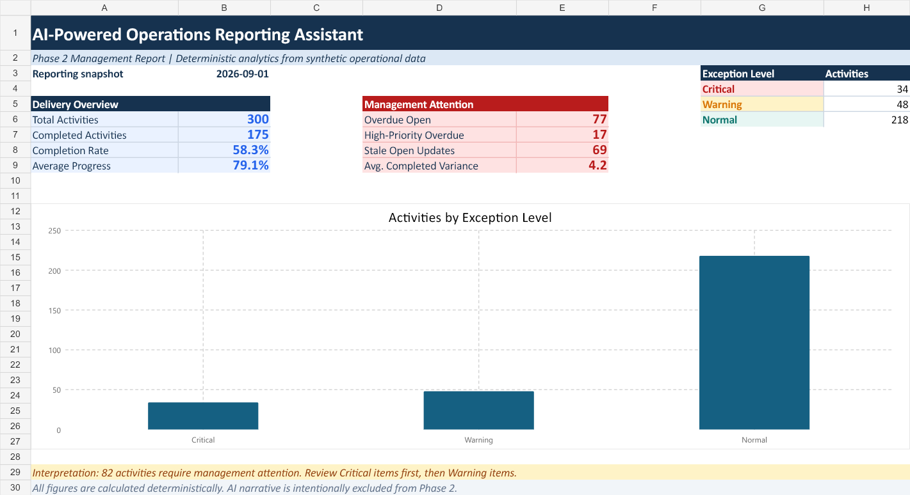
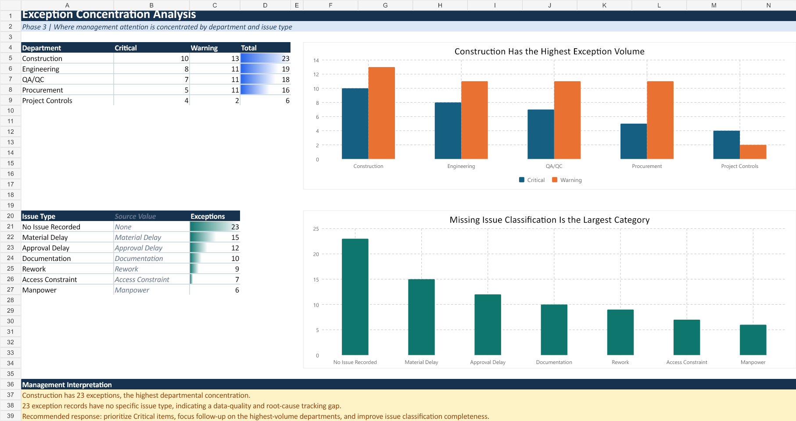

# AI-Powered Operations Reporting Assistant

**Core project · Operations analytics and decision support · Synthetic data**

Converts an operational tracker into validated KPI calculations, prioritized exceptions, and a management briefing. A saved Excel management report makes the results easy to inspect; an optional AI integration turns calculated evidence into a narrative.

**Demonstrated snapshot:** 300 activities · 77 overdue open · 34 Critical and 48 Warning exceptions.

[Download the Excel report](output/operations_management_report.xlsx) · [Read the briefing](output/management_briefing.md) · [Case study](docs/CASE_STUDY.md)



## Business Problem

Operations teams need to identify overdue work, stale updates, and high-priority risks without rebuilding the same management summary manually. Reliable calculations must remain traceable when AI is used to draft the narrative.

## Solution

```text
Operational CSV → validation and cleaning → KPI/risk detection
→ prioritized exceptions → management reporting
→ optional AI-assisted decision support
```

Python calculates the metrics and exception levels. The narrative stage receives the calculated evidence and instructions to preserve the facts. The default path produces a deterministic briefing without an API key.

## Data

The [300-activity dataset](data/operations_data.csv) is fully synthetic, with a fixed reporting snapshot of **1 September 2026**. Validation checks required columns, duplicate activity IDs, and progress values in the 0–100 range. Preparation trims text, parses dates, and derives overdue days, update age, and completed-work schedule variance.

## Analysis

KPIs cover completion, average progress, overdue open work, high-priority overdue work, stale updates, and completed-work schedule variance.

The [exception rules](src/exception_detection.py) classify On Hold activities and High-priority work more than seven days overdue as Critical. Other qualifying activities receive Warning for 1–7 overdue days or an update older than seven days. These are project-specific rules: the exception register is not a complete list of every overdue activity.

## Decision Support

The report supports reviewing Critical cases first, prioritizing high-priority overdue work, refreshing stale updates, and completing missing issue classifications. Construction has the largest exception volume (23); another 23 exception records have no specific issue classification. Missing classification is a data-quality gap, not an established root cause.



## Automated Action

Running `main.py` generates `kpi_summary.json`, `management_exceptions.csv`, `narrative_evidence.json`, and `management_briefing.md` in `output/`.

The included [Excel workbook](output/operations_management_report.xlsx) is a separate saved deliverable with Summary, Visual Analysis, Activity Data, and Exceptions sheets. **The current Python entry point does not rebuild that workbook.** Management follow-up remains a human action.

## Measured / Demonstrated Outcome

| Measure | Saved snapshot |
|---|---:|
| Total / completed activities | 300 / 175 |
| Completion rate | 58.3% |
| Average progress | 79.1% |
| Overdue open activities | 77 |
| High-priority overdue activities | 17 |
| Stale open updates | 69 |
| Critical / Warning exceptions | 34 / 48 |

The [six existing automated checks](tests/test_phase1.py) cover expected KPIs, exception counts, completed-work overdue logic, exception reasons, narrative evidence, and prompt/fallback content. Results demonstrate the supplied synthetic snapshot; no financial savings or realized operational improvement is claimed.

## Tools

Python, pandas, Excel formulas and charts, and an optional OpenAI integration. See [requirements.txt](requirements.txt) for the declared Python dependencies.

## How to Run

From the repository root:

```bash
python -m venv .venv
# Windows PowerShell: .\.venv\Scripts\Activate.ps1
# macOS/Linux: source .venv/bin/activate
python -m pip install -r requirements.txt
python main.py
python -m unittest discover -s tests -v
```

With `OPENAI_API_KEY` unset, the pipeline produces the deterministic briefing. To enable the optional AI narrative, set `OPENAI_API_KEY` and `OPENAI_MODEL` in your process environment using the variable names in [.env.example](.env.example). The code does not automatically load a `.env` file. Choose a model available to your account; never commit an actual key.

The AI path sends the evidence package to the configured service. Its instructions constrain the narrative, but the code does not independently validate the generated text or fall back automatically after an API error. Review an AI-generated briefing against the evidence before use.

For a concise walkthrough, see the [interview guide](docs/INTERVIEW_GUIDE.md).

---

[Portfolio overview](https://github.com/23-06109#selected-projects) · [LinkedIn](https://www.linkedin.com/in/jimmyjrmanalon)
